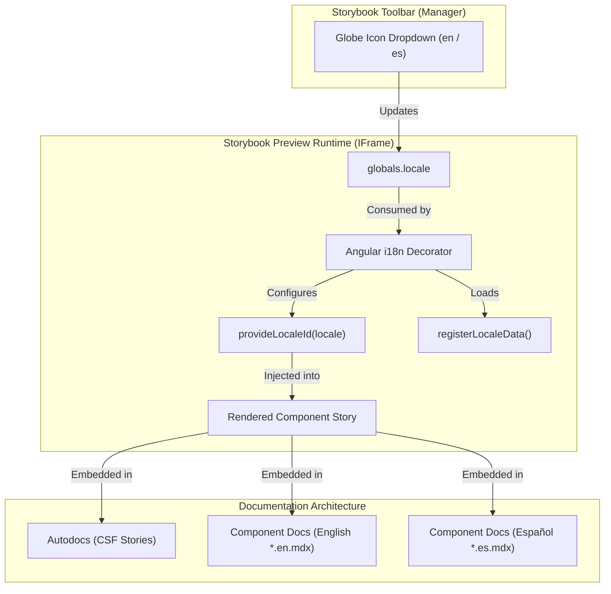

# RFC 0001: Multilingual Documentation & Internationalization in Storybook

- **Status:** Draft / Open for Review
- **Author:** Senior Architecture Team
- **Created:** 2026-10-25
- **Area:** Developer Experience / Storybook (`apps/storybook`) & UI Components (`libs/ui`)
- **Target Release:** v0.2.0

---

## Executive Summary

This RFC establishes the architectural strategy for supporting **multilingual documentation and internationalized component previews** in the `@gacc-ng` design system using **Storybook 10** (`@storybook/angular-vite`).

It addresses two distinct operational dimensions:

1. **Component Canvas Internationalization (i18n):** Enabling developers and designers to dynamically switch languages in the Storybook toolbar (English `en` and Spanish `es`) to test component behavior, string lengths, and accessibility formatting.
2. **Documentation Localization (l10n):** Translating guides, component usage overviews, and explanatory content into English and Spanish across Autodocs and custom MDX pages.

---

## 1. Problem Statement

As `@gacc-ng/ui` grows as an enterprise-grade Angular design system, consumers across Latin America, Spain, and global international teams require documentation in both **Spanish** and **English**.

### Current Limitations:

- **English-Only Canvas & Docs:** All stories, descriptions, Autodocs pages, and code comments are currently authored exclusively in English.
- **Storybook Core Architecture Constraints:** Storybook 10 has no native out-of-the-box translation runtime for static JSDoc comments generated from TypeScript source code during build time.
- **Component Formatting Needs:** Certain primitives (e.g., date pickers, calendars, paginators, aria announcements, and number formats) depend directly on Angular's `LOCALE_ID` and locale data (`@angular/common/locales/*`), which currently defaults only to `en-US`.

---

## 2. Technical Evaluation of Architectural Approaches

We evaluated four candidate architectures for Storybook multi-language support:

| Architecture Pattern                                        | Mechanism                                                                                                    | Pros                                                                                                               | Cons                                                                                                       | Recommendation                             |
| :---------------------------------------------------------- | :----------------------------------------------------------------------------------------------------------- | :----------------------------------------------------------------------------------------------------------------- | :--------------------------------------------------------------------------------------------------------- | :----------------------------------------- |
| **Option A: Global Toolbar + Runtime Decorators**           | Storybook `globalTypes.locale` with toolbar icon + Angular `LOCALE_ID` provider in `preview.ts`.             | • Single Storybook URL/build.<br>• Instant interactive preview switching.<br>• Zero overhead for existing stories. | • Autodocs JSDoc prose remains in source language.                                                         | **Adopt for Component Canvas (Phase 1)**   |
| **Option B: Localized MDX Pages (`*.en.mdx` / `*.es.mdx`)** | Colocated MDX documentation files per language with dedicated sidebar entries or tabs.                       | • Natural prose writing per language.<br>• Full markdown flexibility.<br>• No runtime translation bundle overhead. | • Requires maintaining two MDX files per primitive.<br>• Potential drift between translations.             | **Adopt for Guides & Core Docs (Phase 2)** |
| **Option C: Storybook Multi-Instance Composition**          | Build two distinct Storybook deployments (`/en/` and `/es/`) unified via Storybook URL Composition (`refs`). | • 100% localized experience including UI manager and search.<br>• Zero clutter in the sidebar.                     | • Doubles CI build times.<br>• Higher hosting and maintenance complexity.                                  | **Deferred to Phase 3 (if portal scales)** |
| **Option D: Dynamic In-MDX JSX Conditionals**               | Custom `<LocalizedText en="..." es="..." />` React component inside MDX reading `useGlobals()`.              | • Single MDX file per component.                                                                                   | • Pollutes Markdown ergonomics with verbose wrapper syntax.<br>• Harder for technical writers to maintain. | **Rejected**                               |

---

## 3. Proposed Architecture & Design Specification

We propose a **phased hybrid architecture** that maximizes developer ergonomics and keeps CI fast.



### Phase 1: Component Canvas i18n (Immediate Value)

#### 1. Configure Storybook Globals (`apps/storybook/.storybook/preview.ts`)

Add a global toolbar control with English and Spanish locales:

```typescript
import { registerLocaleData } from '@angular/common';
import localeEs from '@angular/common/locales/es';
import { LOCALE_ID } from '@angular/core';
import type { Preview } from '@storybook/angular';
import { applicationConfig } from '@storybook/angular';

// Register Angular locale data for formatting
registerLocaleData(localeEs);

const preview: Preview = {
    initialGlobals: {
        locale: 'en',
    },
    globalTypes: {
        locale: {
            name: 'Language / Idioma',
            description: 'Internationalization locale',
            toolbar: {
                icon: 'globe',
                items: [
                    { value: 'en', right: '🇬🇧', title: 'English' },
                    { value: 'es', right: '🇪🇸', title: 'Español' },
                ],
                showName: true,
                dynamicTitle: true,
            },
        },
    },
    decorators: [
        applicationConfig({
            providers: [],
        }),
        (storyFn, context) => {
            const currentLocale = context.globals['locale'] || 'en';

            // Provide active LOCALE_ID dynamically
            return storyFn({
                moduleMetadata: {
                    providers: [{ provide: LOCALE_ID, useValue: currentLocale === 'es' ? 'es-ES' : 'en-US' }],
                },
            });
        },
    ],
};

export default preview;
```

#### 2. Localized Primitives & Story Args

Stories that display text or date/number formats can receive locale-aware data:

```typescript
export const LocalizedExample: Story = {
    render: (args, { globals: { locale } }) => ({
        props: {
            ...args,
            label: locale === 'es' ? 'Confirmar acción' : 'Confirm action',
            description: locale === 'es' ? 'Este cambio es irreversible.' : 'This change cannot be undone.',
        },
        template: `
            <div class="flex flex-col gap-2">
                <p class="text-sm text-muted-foreground">{{ description }}</p>
                <button hlmBtn>{{ label }}</button>
            </div>
        `,
    }),
};
```

---

### Phase 2: Documentation Localization Strategy

For detailed documentation, we avoid heavy runtime translation machinery in favor of clear, readable **colocated MDX files**:

#### Structure:

```text
libs/ui/button/
├── src/
│   ├── index.ts
│   └── lib/
│       ├── hlm-button.directive.ts
│       ├── hlm-button.stories.ts
│       ├── button.en.mdx       # English comprehensive documentation
│       └── button.es.mdx       # Spanish comprehensive documentation
```

#### Markdown Hierarchy (Storybook Sidebar):

Using standard CSF titles, the documentation pages will group naturally:

- `Primitives/Button/Documentation (EN)`
- `Primitives/Button/Documentación (ES)`

This keeps both translations in source control next to the code, enabling peer review in pull requests whenever component APIs change.

---

### Phase 3: Future Scalability (Storybook Composition)

When the design system reaches full enterprise maturity (>50 components and full custom site deployment):

- CI can build two static Storybook bundles:
    - `dist/storybook/en`
    - `dist/storybook/es`
- A top-level landing page or reverse proxy routes users based on their browser preferences (`Accept-Language`).

---

## 4. Implementation Checklist

- [ ] **Task 1: Add Storybook Global Toolbar (`apps/storybook/.storybook/preview.ts`)**
    - Add `globalTypes.locale` with `en` and `es`.
    - Register Angular locale data (`@angular/common/locales/es`).
- [ ] **Task 2: Add Global Angular Locale Provider Decorator**
    - Inject dynamic `LOCALE_ID` based on `context.globals.locale`.
- [ ] **Task 3: Update RTL & Direction Support (Optional Future Extension)**
    - Add optional text direction global (`dir: ltr | rtl`) for bidirectional layout verification.
- [ ] **Task 4: Author Proof of Concept on a Complex Component (e.g., `dialog` or `calendar`)**
    - Add bilingual story examples and verify toolbar switching.
- [ ] **Task 5: Establish Contributor Documentation Guidelines**
    - Document the convention for authoring bilingual stories and MDX guides in `CONTRIBUTING.md`.

---

## 5. Alternatives Considered

1. **Third-party community addons (e.g. `storybook-i18n`, `storybook-react-i18next`):**
    - Most community addons are tightly coupled to React or React-i18next runtimes. In an Angular 22 + Vite monorepo, using native Storybook 10 `globalTypes` + Angular `applicationConfig` is significantly cleaner, lighter, and zero-dependency.

2. **Automated Machine Translation at Build Time:**
    - Translating MDX files via LLM/Google Translate during CI builds introduces non-deterministic builds and risk of inaccurate technical terminology. Human-curated translations in Git ensure high quality and professional precision.

---

## 6. Feedback & Discussion

Please submit review feedback or suggestions via comments on the RFC pull request:

- Should Spanish be the default locale for certain deployment targets, or keep English as canonical default?
- Should we provide a schematic or generator flag (`--i18n`) for new component stories?
