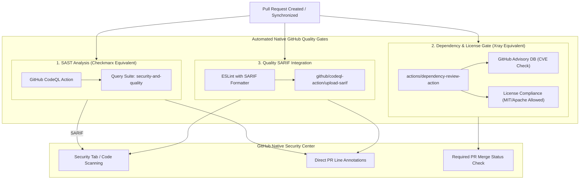

# RFC 0002: Native GitHub Code Security & Quality Architecture

- **Status:** Draft / Open for Review
- **Author:** Senior Architecture Team
- **Created:** 2026-10-25
- **Area:** CI/CD, DevSecOps, Code Quality & Security Governance
- **Target Release:** v0.2.0

---

## Executive Summary

This RFC defines the DevSecOps and code quality architecture for the `@gacc-ng` design system using **100% native GitHub Advanced Security (GHAS) and GitHub Actions capabilities**.

It directly replaces external, heavyweight enterprise scanners like **Checkmarx** (SAST) and **JFrog Xray** (SCA / License compliance) with native GitHub platform tooling:

1. **GitHub CodeQL (SAST):** Deep semantic source-code analysis replacing external SAST platforms (Checkmarx, SonarQube, Veracode).
2. **GitHub Dependency Review & Dependabot (SCA):** Real-time dependency vulnerability and license compliance scanning replacing external artifact scanners (JFrog Xray, Snyk).
3. **Secret Scanning & Push Protection:** Native pre-receive secret scanning preventing token, key, and certificate leaks.
4. **SARIF Code Quality Integration:** Ingesting ESLint and TypeScript quality findings directly into the GitHub Code Scanning dashboard.
5. **OpenSSF Scorecard:** Automated supply chain security posture and hardening audits.

---

## 1. Problem Statement & Motivation

As `@gacc-ng/ui` serves as the foundational component library across core applications, security vulnerabilities and code quality regressions introduce exponential risk downstream.

### Current Challenges:

- **No Automated SAST in CI:** While ESLint enforces Angular architecture standards, source-code security vulnerabilities (e.g., prototype pollution, DOM XSS in safe HTML pipes, regex DDoS, insecure deserialization) are not currently audited by semantic data-flow engines.
- **Dependency Ingestion Blindspots (SCA):** While Dependabot runs scheduled updates weekly, incoming pull requests lack an automated gate that blocks the introduction of newly vulnerable packages or restrictive/incompatible licenses (e.g., GPL in an MIT library).
- **Fragmented Developer Experience:** External security tools require separate dashboards, API keys, authentication tokens, and disparate reporting formats that increase cognitive load and slow down code reviews.

---

## 2. Tool Mapping: Legacy Enterprise vs. GitHub Native

| Security Capability                            | Legacy Enterprise Tool              | GitHub Native Replacement                    | Integration Mechanism                                                                 |
| :--------------------------------------------- | :---------------------------------- | :------------------------------------------- | :------------------------------------------------------------------------------------ |
| **SAST (Static Application Security Testing)** | Checkmarx SAST / SonarQube          | **GitHub CodeQL**                            | `github/codeql-action` scanning `javascript-typescript` on PRs and default branch.    |
| **SCA (Software Composition Analysis)**        | JFrog Xray / Snyk Open Source       | **GitHub Dependency Review + Dependabot**    | `actions/dependency-review-action` checking diffs against GitHub Advisory Database.   |
| **License Compliance**                         | JFrog Xray License Policies / FOSSA | **GitHub Dependency Review Action**          | Policy-based license filtering (`allow-licenses` / `deny-licenses`) on PR boundaries. |
| **Secret Detection**                           | GitGuardian / Trufflehog            | **GitHub Secret Scanning & Push Protection** | Native GitHub repository governance + pre-commit Lefthook entropy checks.             |
| **Supply Chain & Posture**                     | OpenSSF SLSA / Scorecard            | **OpenSSF Scorecard Action**                 | `ossf/scorecard-action` running weekly audits with SARIF export.                      |
| **Code Quality Dashboard**                     | SonarQube Quality Gates             | **ESLint SARIF Export**                      | Emitting `@microsoft/eslint-formatter-sarif` to GitHub Code Scanning.                 |

---

## 3. Technical Architecture & Workflow Specifications



---

### Specification 1: GitHub CodeQL Analysis (`.github/workflows/codeql.yml`)

CodeQL builds a semantic database of the AST, data flows, and control graphs of the codebase to detect CWEs with precision.

```yaml
name: Security - CodeQL (SAST)

on:
    push:
        branches: [main]
    pull_request:
        branches: [main]
    schedule:
        - cron: '0 3 * * 1' # Weekly Monday scan at 03:00 UTC

concurrency:
    group: ${{ github.workflow }}-${{ github.ref }}
    cancel-in-progress: true

permissions:
    actions: read
    contents: read
    security-events: write

jobs:
    analyze:
        name: CodeQL Semantic Analysis
        runs-on: ubuntu-latest
        timeout-minutes: 15

        steps:
            - name: Checkout repository
              uses: actions/checkout@v7

            - name: Initialize CodeQL
              uses: github/codeql-action/init@v3
              with:
                  languages: javascript-typescript
                  queries: security-and-quality

            - name: Perform CodeQL Analysis
              uses: github/codeql-action/analyze@v3
              with:
                  category: '/language:javascript-typescript'
```

---

### Specification 2: Dependency & License Review (`.github/workflows/dependency-review.yml`)

Runs strictly on pull requests modifying package dependencies (`package.json`, `pnpm-lock.yaml`), evaluating diffs before merge.

```yaml
name: Security - Dependency & License Review (SCA)

on:
    pull_request:
        paths:
            - 'package.json'
            - 'pnpm-lock.yaml'

permissions:
    contents: read
    pull-requests: write

jobs:
    dependency-review:
        name: Dependency & License Compliance
        runs-on: ubuntu-latest
        steps:
            - name: Checkout repository
              uses: actions/checkout@v7

            - name: Dependency Review Action
              uses: actions/dependency-review-action@v4
              with:
                  fail-on-severity: high
                  allow-licenses: 'MIT, Apache-2.0, BSD-2-Clause, BSD-3-Clause, ISC, CC0-1.0, 0BSD'
                  deny-packages: ''
                  comment-summary-in-pr: always
```

---

### Specification 3: Secret Scanning & Push Protection

Native GitHub Secret Scanning detects high-entropy tokens and API keys across all commits:

1. **Push Protection:** Block commits containing known secret patterns (Stripe, AWS, NPM, GitHub tokens) before they enter the repository history.
2. **Pre-commit Hook Layer (Lefthook):** Complement GitHub's server-side protection with a local pre-commit check using standard regex checks in `lefthook.yml`.

---

### Specification 4: Unified Code Quality SARIF Ingestion

Exporting project linting results directly into the GitHub Security/Code Scanning tab eliminates third-party PR comment spam and unifies all warnings under a single interface:

```bash
pnpm eslint . --format @microsoft/eslint-formatter-sarif --output-file eslint-results.sarif
```

The SARIF file is then uploaded via `github/codeql-action/upload-sarif`, enabling inline code scanning alerts with zero third-party dependencies.

---

## 4. Rollout Strategy & Phased Implementation

To prevent disruption to active development, we propose a two-phase rollout:

### Phase 1: Advisory & Baseline (Weeks 1-2)

- Deploy `.github/workflows/codeql.yml` and `.github/workflows/dependency-review.yml`.
- Configure checks in **informational mode** (`continue-on-error: true` or non-blocking status checks).
- Audit the initial baseline findings and address existing technical debt.
- Enable GitHub Secret Scanning & Push Protection in repository settings.

### Phase 2: Enforced Quality Gates (Week 3+)

- Promote CodeQL and Dependency Review to **Required Status Checks** in the GitHub branch protection rules for `main`.
- Block PRs introducing:
    - Any `High` or `Critical` CodeQL security vulnerability.
    - Any dependency with known `High`/`Critical` CVEs.
    - Any dependency with non-compliant open source licensing.

---

## 5. Alternatives Considered & Tradeoff Analysis

| Consideration               | Native GitHub Stack (Proposed)                                 | Third-Party Vendor (Checkmarx / JFrog Xray / SonarCloud)                         |
| :-------------------------- | :------------------------------------------------------------- | :------------------------------------------------------------------------------- |
| **Infrastructure Overhead** | Zero. Runs entirely on existing GitHub Actions runners.        | High. Requires separate SaaS accounts, webhooks, API tokens, and runner proxies. |
| **Cost**                    | Free for public repositories / included in GitHub Enterprise.  | High recurring license cost per seat / repository.                               |
| **Developer Ergonomics**    | Native PR annotations, native Security tab, zero extra logins. | External portal redirects, duplicate notification streams.                       |
| **Maintenance Burden**      | Managed actions maintained directly by GitHub and OpenSSF.     | Custom pipeline plugins, vendor SDK deprecations, version drift.                 |

---

## 6. Implementation Checklist

- [ ] **Task 1: Add CodeQL Workflow (`.github/workflows/codeql.yml`)**
    - Configure `javascript-typescript` language analysis.
    - Set `security-and-quality` query suite.
- [ ] **Task 2: Add Dependency Review Workflow (`.github/workflows/dependency-review.yml`)**
    - Set `fail-on-severity: high`.
    - Configure approved permissive open-source license list (MIT, Apache 2.0, BSD).
- [ ] **Task 3: Verify Repository Secret Scanning & Push Protection Settings**
    - Enable Secret Scanning & Push Protection on `gacc-ng/design-system`.
- [ ] **Task 4: Add SARIF Export Target for ESLint in `package.json`**
    - Add `@microsoft/eslint-formatter-sarif` devDependency.
    - Add `pnpm nx run-many -t lint --sarif` workflow step.
- [ ] **Task 5: Update Branch Protection Rules on `main`**
    - Require CodeQL and Dependency Review checks before merge after baseline stabilization.

---

## 7. Open Questions for Discussion

1. Should `dependency-review-action` fail on `moderate` severity CVEs or strictly `high`/`critical`? (Recommended: `high` to avoid blocking development on devDependency false positives).
2. Should we also introduce `ossf/scorecard-action` to monitor supply chain health publicly in the repository README?
