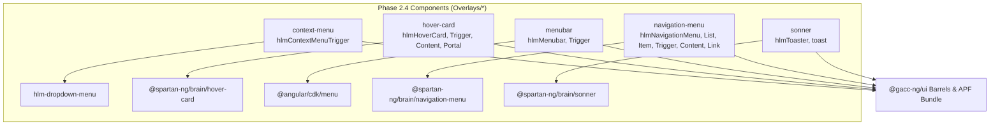

# Implementation Plan: Phase 2.4 Overlay Menus & Toast Notifications

Derived from **GitHub Issue #130** and **RFC #126**.

## Goal Description

Expand `@gacc-ng/ui` by implementing the **5 Phase 2.4 overlay and advanced menu primitives**:

1. **`context-menu`**: Cursor-anchored contextual popover triggered on secondary click / long-press, hosting `CdkContextMenuTrigger` and integrating seamlessly with `hlm-dropdown-menu`.
2. **`hover-card`**: Rich preview popover triggered on pointer hover with configurable enter/exit delays, backed by `@spartan-ng/brain/hover-card`.
3. **`menubar`**: Desktop-grade persistent horizontal application menu toolbar with keyboard access and cascading submenus via `@angular/cdk/menu`.
4. **`navigation-menu`**: Responsive, multi-column mega-menu with viewport positioning and animated disclosure transitions, backed by `@spartan-ng/brain/navigation-menu`.
5. **`sonner`**: Stacked, swipeable, animated toast notification manager with auto-dismiss timers and action button slots, backed by `@spartan-ng/brain/sonner`.

All components will strictly follow our established standards:

- **Clean File Naming:** No `.component.ts` or `.directive.ts` suffixes; direct primitive/slot filenames (`hlm-context-menu-trigger.ts`, `hlm-hover-card.ts`, `hlm-menubar.ts`, `hlm-navigation-menu.ts`, `hlm-toaster.ts`, etc.).
- **Signal-first & Zoneless:** Angular 22 `input()`, `computed()`, `output()`, and `ChangeDetectionStrategy.OnPush`.
- **Secondary Entrypoints:** Minimal `ng-package.json` (`{"lib": {"entryFile": "src/index.ts"}}`).
- **Storybook Autodocs:** Placed strictly under the `Overlays/*` category taxonomy.

---

## User Review Required

> [!NOTE]
> All underlying headless primitives (`@spartan-ng/brain/hover-card`, `@spartan-ng/brain/navigation-menu`, `@spartan-ng/brain/sonner`, and `@angular/cdk/menu`) are already installed and tested in the workspace. No new third-party dependencies are required.

> [!IMPORTANT]
> **Component Interoperability:**
>
> - `context-menu` and `menubar` reuse the existing `HlmDropdownMenuImports` primitives (`<hlm-dropdown-menu>`, `<button hlmDropdownMenuItem>`, separators, checkboxes, and radio groups) as menu surfaces, adhering directly to upstream Spartan NG design patterns.
> - `sonner` provides the `<hlm-toaster />` component and re-exports the `toast` imperative dispatcher from `@spartan-ng/brain/sonner`.

---

## Open Questions

None. The specifications, acceptance criteria in Issue #130, and upstream Spartan NG implementations are completely aligned.

---

## Proposed Changes



### 1. Workspace Configuration & Barrels

#### [MODIFY] tsconfig.base.json

- Register the 5 new secondary entrypoints under `paths`:
    - `@gacc-ng/ui/context-menu`: `["libs/ui/context-menu/src/index.ts"]`
    - `@gacc-ng/ui/hover-card`: `["libs/ui/hover-card/src/index.ts"]`
    - `@gacc-ng/ui/menubar`: `["libs/ui/menubar/src/index.ts"]`
    - `@gacc-ng/ui/navigation-menu`: `["libs/ui/navigation-menu/src/index.ts"]`
    - `@gacc-ng/ui/sonner`: `["libs/ui/sonner/src/index.ts"]`

#### [MODIFY] libs/ui/src/index.ts

- Export secondary packages from root package entrypoint:
    ```typescript
    export * from '@gacc-ng/ui/context-menu';
    export * from '@gacc-ng/ui/hover-card';
    export * from '@gacc-ng/ui/menubar';
    export * from '@gacc-ng/ui/navigation-menu';
    export * from '@gacc-ng/ui/sonner';
    ```

#### [MODIFY] libs/ui/src/barrels.spec.ts

- Expand barrel validation tests from 50 to 55 entry points, asserting export integrity for `HlmContextMenuImports`, `HlmHoverCardImports`, `HlmMenubarImports`, `HlmNavigationMenuImports`, and `HlmToasterImports`.

---

### 2. Component: `context-menu` (`libs/ui/context-menu`)

#### [NEW] libs/ui/context-menu/ng-package.json

- Minimal secondary entrypoint definition.

#### [NEW] libs/ui/context-menu/README.md

- API documentation, trigger usage, and pairing with `hlm-dropdown-menu`.

#### [NEW] libs/ui/context-menu/src/index.ts

- Export `HlmContextMenuTrigger`, config tokens/providers, and canonical barrel:
    ```typescript
    export * from './lib/hlm-context-menu-trigger';
    export const HlmContextMenuImports = [HlmContextMenuTrigger] as const;
    ```

#### [NEW] libs/ui/context-menu/src/lib/hlm-context-menu-trigger.ts

- Directive hosting `CdkContextMenuTrigger` with `MENU_SIDE` provider, `createMenuPosition(align, side)`, and `data-slot="context-menu-trigger"`.

#### [NEW] libs/ui/context-menu/src/lib/hlm-context-menu.spec.ts

- Unit tests verifying right-click trigger, opening attached menu template, and disabling via signal input.

#### [NEW] libs/ui/context-menu/src/lib/hlm-context-menu.stories.ts

- Autodocs story under `Overlays/Context Menu` featuring submenus, shortcuts, checkbox items, and radio groups.

---

### 3. Component: `hover-card` (`libs/ui/hover-card`)

#### [NEW] libs/ui/hover-card/ng-package.json

- Minimal secondary entrypoint definition.

#### [NEW] libs/ui/hover-card/README.md

- API documentation and delay configuration.

#### [NEW] libs/ui/hover-card/src/index.ts

- Export `HlmHoverCard`, `HlmHoverCardTrigger`, `HlmHoverCardContent`, `HlmHoverCardPortal`, and canonical barrel `HlmHoverCardImports`.

#### [NEW] libs/ui/hover-card/src/lib/hlm-hover-card.ts

- Container directive hosting `BrnHoverCard`.

#### [NEW] libs/ui/hover-card/src/lib/hlm-hover-card-trigger.ts

- Trigger directive hosting `BrnHoverCardTrigger` with `showDelay`, `hideDelay`, `align`, and `sideOffset`.

#### [NEW] libs/ui/hover-card/src/lib/hlm-hover-card-content.ts

- Content directive with animated popover styling and state attributes (`data-state`, `data-side`).

#### [NEW] libs/ui/hover-card/src/lib/hlm-hover-card-portal.ts

- Portal directive hosting `BrnHoverCardContent`.

#### [NEW] libs/ui/hover-card/src/lib/hlm-hover-card.spec.ts

- Unit tests verifying hover trigger interaction, state change, and DOM rendering.

#### [NEW] libs/ui/hover-card/src/lib/hlm-hover-card.stories.ts

- Autodocs story under `Overlays/Hover Card` showing avatar preview card with join date and metadata.

---

### 4. Component: `menubar` (`libs/ui/menubar`)

#### [NEW] libs/ui/menubar/ng-package.json

- Minimal secondary entrypoint definition.

#### [NEW] libs/ui/menubar/README.md

- Menubar hierarchy, triggers, and keyboard navigation.

#### [NEW] libs/ui/menubar/src/index.ts

- Export `HlmMenubar`, `HlmMenubarTrigger`, config providers, and `HlmMenubarImports`.

#### [NEW] libs/ui/menubar/src/lib/hlm-menubar.ts

- Menubar host directive hosting `CdkMenuBar` with `bg-background h-8 gap-0.5 rounded-lg border p-[3px] flex items-center`.

#### [NEW] libs/ui/menubar/src/lib/hlm-menubar-trigger.ts

- Button directive hosting `CdkMenuItem` and `CdkMenuTrigger` with `updateMenuPosition`.

#### [NEW] libs/ui/menubar/src/lib/hlm-menubar.spec.ts

- Unit tests validating horizontal menu trigger activation, focus advancement, and submenu opening.

#### [NEW] libs/ui/menubar/src/lib/hlm-menubar.stories.ts

- Autodocs story under `Overlays/Menubar` providing a full File / Edit / View / Profiles application menubar.

---

### 5. Component: `navigation-menu` (`libs/ui/navigation-menu`)

#### [NEW] libs/ui/navigation-menu/ng-package.json

- Minimal secondary entrypoint definition.

#### [NEW] libs/ui/navigation-menu/README.md

- Mega-menu layout, viewport handling, and responsive navigation.

#### [NEW] libs/ui/navigation-menu/src/index.ts

- Export all navigation menu primitives and `HlmNavigationMenuImports`.

#### [NEW] libs/ui/navigation-menu/src/lib/hlm-navigation-menu.ts

- Host nav directive with `BrnNavigationMenu`.

#### [NEW] libs/ui/navigation-menu/src/lib/hlm-navigation-menu-list.ts

- List container directive with `BrnNavigationMenuList`.

#### [NEW] libs/ui/navigation-menu/src/lib/hlm-navigation-menu-item.ts

- List item directive with `BrnNavigationMenuItem`.

#### [NEW] libs/ui/navigation-menu/src/lib/hlm-navigation-menu-trigger.ts

- Trigger component hosting `BrnNavigationMenuTrigger` with animated chevron indicator.

#### [NEW] libs/ui/navigation-menu/src/lib/hlm-navigation-menu-content.ts

- Content container with directional sliding animation classes (`from-start`, `from-end`, etc.).

#### [NEW] libs/ui/navigation-menu/src/lib/hlm-navigation-menu-link.ts

- Navigation link directive with `BrnNavigationMenuLink`.

#### [NEW] libs/ui/navigation-menu/src/lib/hlm-navigation-menu-portal.ts

- Portal directive hosting `BrnNavigationMenuContent`.

#### [NEW] libs/ui/navigation-menu/src/lib/hlm-navigation-menu.spec.ts

- Unit tests verifying hover/click disclosure, link activation, and keyboard navigation.

#### [NEW] libs/ui/navigation-menu/src/lib/hlm-navigation-menu.stories.ts

- Autodocs story under `Overlays/Navigation Menu` showing a modern website navigation header with multi-column card contents.

---

### 6. Component: `sonner` (`libs/ui/sonner`)

#### [NEW] libs/ui/sonner/ng-package.json

- Minimal secondary entrypoint definition.

#### [NEW] libs/ui/sonner/README.md

- Toast manager installation, `<hlm-toaster />` placement, and `toast()` API examples (success, error, promise, action).

#### [NEW] libs/ui/sonner/src/index.ts

- Export `HlmToaster`, `HlmToasterImports`, and re-export `toast` from `@spartan-ng/brain/sonner`.

#### [NEW] libs/ui/sonner/src/lib/hlm-toaster.ts

- Component wrapping `<brn-sonner-toaster>` with styled action/cancel buttons, Lucide icons (`lucideCircleCheck`, `lucideInfo`, `lucideTriangleAlert`, `lucideOctagonX`, `lucideLoader2`), and signal inputs (`position`, `duration`, `richColors`, `expand`, `closeButton`).

#### [NEW] libs/ui/sonner/src/lib/hlm-toaster.spec.ts

- Unit tests asserting toaster initialization, action button rendering, and toast dispatching.

#### [NEW] libs/ui/sonner/src/lib/hlm-sonner.stories.ts

- Autodocs story under `Overlays/Sonner` with interactive buttons triggering default, success, error, warning, info, and action toasts.

---

## Verification Plan

### Automated Tests

1. **Formatting:** `pnpm run format:check`
2. **Unit Tests:** `pnpm nx test ui` (verifying all 55 entry points pass 100%)
3. **Linting:** `pnpm nx run-many -t lint` (ui, showcase, storybook, schematics)
4. **Library Build:** `pnpm nx build ui` (APF compilation of all 55 secondary entry points)
5. **Storybook Build:** `pnpm nx run storybook:build-storybook -c ci` (0 errors)

### Manual Verification

1. Access the local Storybook dev server (`http://127.0.0.1:4400/`).
2. Verify all 5 primitives render cleanly under the `Overlays/*` sidebar section:
    - `Overlays/Context Menu` -> Right click to verify dropdown menu positioning and submenus.
    - `Overlays/Hover Card` -> Hover to verify smooth enter/exit delay and card positioning.
    - `Overlays/Menubar` -> Click and arrow-navigate across horizontal menus.
    - `Overlays/Navigation Menu` -> Hover triggers to verify animated multi-column dropdowns.
    - `Overlays/Sonner` -> Click buttons to trigger toast notifications in bottom-right corner.
